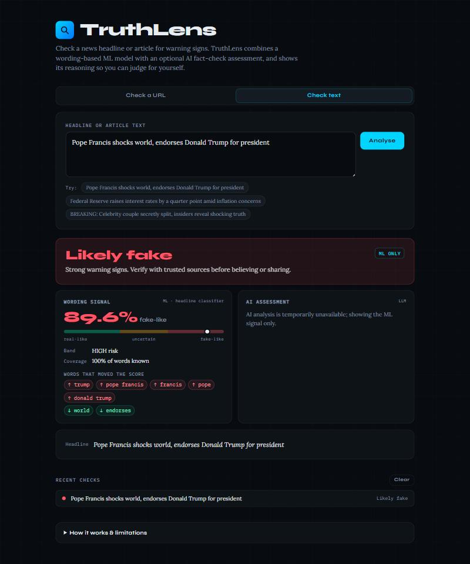
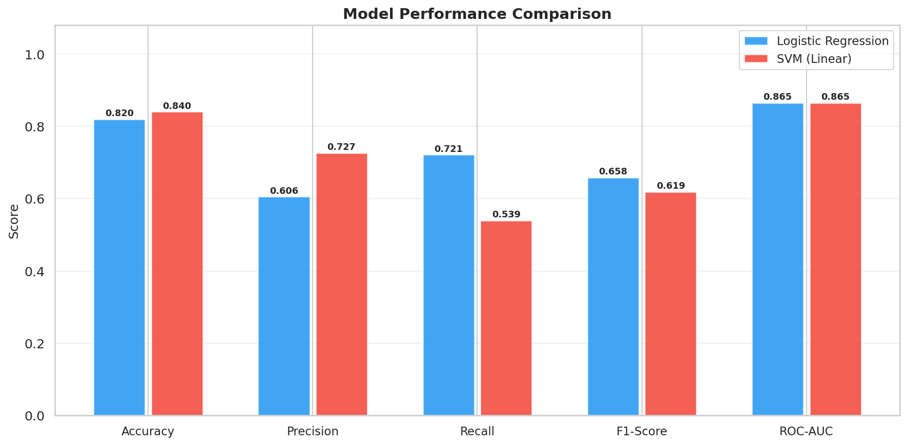
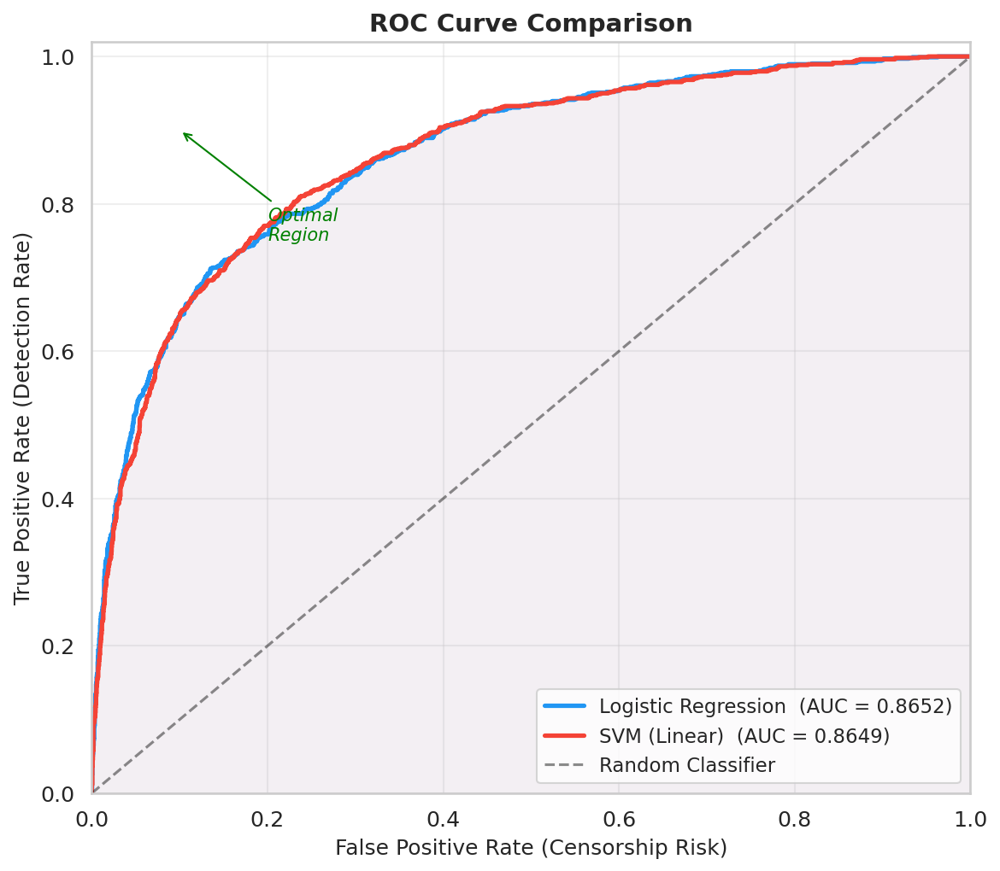
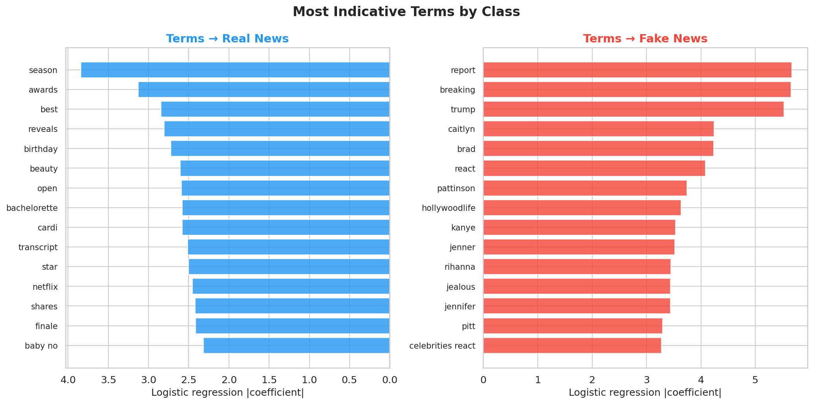

 <div align="center">

# 🔍 TruthLens — News Credibility Checker

### Explainable Machine Learning + Optional AI-Assisted News Credibility Assessment

**Credibility signals, not a final ruling.**

[](https://www.python.org/)
[](https://flask.palletsprojects.com/)
[](#-what-it-does)
[](#-configuration)
[](#-tests-and-code-quality)
[](#-license)

[Overview](#-what-it-does) · [Results](#-model-results) · [Architecture](#-architecture) · [Setup](#-setup) · [API](#-http-api) · [Deployment](#-deployment) · [Security](#-security-and-privacy)

</div>

---

## 📖 Overview

Paste a news URL or headline to receive credibility signals: a wording-based ML score with word-level explanations, plus an optional AI assessment of sourcing, plausibility, and manipulation techniques.

**TruthLens provides signals, not a final ruling.** It is designed to help users investigate news claims, understand how wording influences a model's prediction, and identify points that warrant further verification.



---

## 🔍 What It Does

TruthLens combines two complementary signals.

| Signal | How It Works | Strengths | Limitations |
|---|---|---|---|
| **Wording signal (ML)** | TF-IDF with unigrams and bigrams, followed by class-balanced logistic regression. Trained on approximately 21.6k real headlines labelled by fact-checkers using [FakeNewsNet](https://github.com/KaiDMML/FakeNewsNet). | Fast, deterministic, works offline, and explains which words influenced the score. | Evaluates wording rather than facts. Trained on 2016–2018 US politics and celebrity news. |
| **AI assessment (optional)** | A Groq-hosted LLM, defaulting to `llama-3.3-70b-versatile`, reviews sourcing, plausibility, and manipulation techniques and suggests claims to verify. | Can reason about the submitted content and identify possible red flags. | Non-deterministic, cannot browse the web, and can be wrong. |

### Verdicts and Signal Agreement

The overall verdict is one of:

- **Likely fake**
- **Uncertain**
- **Likely credible**
- **Not enough signal**

When the LLM is available, its verdict is used; otherwise, the ML signal is used. Both raw signals are always displayed, and disagreement between them is flagged.

If the ML model recognises none of the words in the submitted text, it reports that limitation instead of guessing.

---

## 📊 Model Results

The following results come from a **held-out test set of 4,318 headlines**.

The served model is logistic regression. All reported metrics use a stratified 80/20 split, with deduplicated titles to prevent the same headline from appearing in both training and test sets. Regularisation was selected using five-fold cross-validation on the training split only.

### Model Comparison

| Model | Accuracy | Precision (Fake) | Recall (Fake) | F1 (Fake) | ROC-AUC |
|---|---:|---:|---:|---:|---:|
| **Logistic Regression (served)** | 0.820 | 0.606 | 0.721 | 0.659 | **0.865** |
| SVM (linear, calibrated) | 0.840 | 0.727 | 0.539 | 0.619 | 0.865 |

Only 24% of headlines are fake, so accuracy alone can be misleading: a model that always answers “real” would score 76%.

ROC-AUC and fake-class F1 are more informative metrics in this setting. The cross-validated ROC-AUC is **0.870 ± 0.006**.

### Model Comparison Chart



### ROC Curves



### Most Indicative Terms



The most indicative terms illustrate an important limitation: the model partly learns **topics**, including celebrity names and “trump,” in addition to stylistic terms such as “breaking,” “report,” and “jealous.”

This is a known property of FakeNewsNet. TruthLens therefore presents the ML score as one imperfect signal, exposes the words behind it, and pairs it with the optional AI assessment rather than treating it as definitive evidence.

### What the Verdict Bands Mean

The following figures describe the served model's verdict bands on the test set.

| Verdict | Share of Headlines | Actually Fake |
|---|---:|---:|
| Likely fake (\(P \geq 0.65\)) | 19.6% | **71%** |
| Uncertain | 21.9% | 27% |
| Likely credible (\(P < 0.35\)) | 58.5% | 7% |

Subset results:

| Dataset Subset | ROC-AUC |
|---|---:|
| GossipCop — celebrity news | 0.869 |
| PolitiFact — politics | 0.813 |

### Historical Note on Version 1

The original version trained on 6,000 template-generated headlines. It achieved 100% accuracy on its own templates but failed to generalise to real news. For example, “Pope Francis endorses Donald Trump” received a fake probability of just 0.2%.

The PDF report in the repository describes that earlier version.

---

## 🏗️ Architecture

TruthLens separates request handling, URL fetching, signal analysis, model inference, and LLM assessment.

```text
Browser (templates/index.html + static/app.js, strict CSP)
   │  POST /api/verify-text {text}      POST /api/verify-url {url}
   ▼
app.py — Flask app factory: validation, rate limit, security headers, JSON errors
   │                                        │
   │                              src/scraper.py — SSRF-safe fetch + HTML extraction
   ▼                                        ▼
src/analysis.py — Analyzer: combines signals, flags disagreement
   ├── src/predict.py — Predictor: TF-IDF → logistic regression, explanations
   │      (models/*.pkl + models/model_card.json, produced by main.py)
   └── src/llm.py — GroqClient: JSON mode, schema validation, retries, injection hardening
```

### Project Structure

```text
fake-news-detector/
├── app.py               # Flask web app (factory: create_app)
├── main.py              # Training pipeline → models/ + reports/
├── verify.py            # CLI verifier (same analysis as the web app)
├── src/
│   ├── config.py        # Validated settings from environment variables
│   ├── data_loader.py   # FakeNewsNet download/load/dedup (+ synthetic test fixture)
│   ├── preprocessor.py  # Deterministic text cleaning (no network)
│   ├── features.py      # TF-IDF extractor
│   ├── models.py        # LR / SVM wrappers
│   ├── evaluate.py      # Metrics, per-subset and per-band evaluation
│   ├── predict.py       # Predictor (single inference path) + model card loading
│   ├── analysis.py      # Combines ML + LLM into the API result
│   ├── llm.py           # Groq client
│   ├── scraper.py       # URL fetching with SSRF protection
│   └── visualize.py     # Training figures
├── templates/index.html, static/app.{css,js}
├── tests/               # 166 tests (pytest)
├── Dockerfile, docker-compose.yml, .github/workflows/ci.yml
└── requirements.txt, requirements-dev.txt, .env.example
```

---

## ⚙️ Setup

Requires **Python 3.12+** (3.13 tested).

### 1. Clone the Repository

```bash
git clone https://github.com/OmjeeRGiri/fake-news-detector.git
cd fake-news-detector
```

### 2. Create and Activate a Virtual Environment

```bash
python -m venv venv
```

**Windows**

```powershell
venv\Scripts\activate
```

**macOS / Linux**

```bash
source venv/bin/activate
```

### 3. Install Dependencies

```bash
pip install -r requirements-dev.txt
```

### 4. Configure the Environment

Copy `.env.example` to `.env`:

```bash
cp .env.example .env
```

On Windows Command Prompt:

```bat
copy .env.example .env
```

Add your `GROQ_API_KEY` to `.env` to enable the optional AI assessment. Without a key, the application operates in ML-only mode.

---

## 🧠 Training the Model

Train the model once, approximately **1.5–3 minutes**:

```bash
python main.py
```

This downloads FakeNewsNet (~44 MB, cached in `data/raw/fakenewsnet/`), trains LR and SVM, evaluates them, writes figures to `reports/figures/`, and saves:

- `models/logistic_regression.pkl`
- `models/tfidf_vectorizer.pkl`
- `models/model_card.json`

The model card records dataset checksums, metrics, thresholds, and the scikit-learn version.

### Training Options

| Option | Purpose |
|---|---|
| `--no-plots` | Skip plot generation. |
| `--no-cv` | Skip cross-validation. |
| `--models-dir DIR` | Specify the model output directory. |
| `--data synthetic` | Run an offline smoke test using synthetic data. |

`--data synthetic` gives an offline smoke run; the resulting model is flagged as a **demo** in the UI.

---

## 🌐 Running the Web Application

### Development

```bash
python app.py
```

Open [http://localhost:5000](http://localhost:5000).

### Production

For Windows, macOS, and Linux:

```bash
waitress-serve --listen=0.0.0.0:8000 --threads=8 --call app:create_app
```

If `waitress-serve` isn't on your PATH, `python -m waitress …` is equivalent.

---

## 💻 Command-Line Interface

The `verify.py` script provides the same analysis as the web application.

### Interactive Mode

```bash
python verify.py
```

### Verify a Headline

```bash
python verify.py --text "BREAKING: ..."
```

### Verify a URL

```bash
python verify.py --url https://www.bbc.com/news/...
```

### JSON Output — ML Only

```bash
python verify.py --text "..." --json --no-llm
```

---

## 🧪 Tests and Code Quality

Run the test suite:

```bash
pytest
```

The original suite contains **166 tests**, takes approximately five seconds, and requires no network access.

Run linting:

```bash
ruff check .
```

---

## 🔌 HTTP API

| Method | Path | Body | Notes |
|---|---|---|---|
| `POST` | `/api/verify-text` | `{"text": "..."}` (5–5,000 chars) | First line is scored by the ML model; full text goes to the LLM. |
| `POST` | `/api/verify-url` | `{"url": "https://..."}` | 422 with a readable `error` if the page can't be fetched. |
| `GET` | `/api/model-info` | — | Model name, dataset, held-out metrics, whether the LLM is enabled. |
| `GET` | `/healthz` | — | Liveness. |
| `GET` | `/readyz` | — | Readiness (model loaded). |

### Example Response

```json
{
  "verdict": "LIKELY_FAKE",
  "verdict_basis": "llm+ml",
  "agreement": "agree",
  "ml": {
    "risk_score": 0.896,
    "risk_level": "HIGH",
    "coverage": 1.0,
    "explanation": {
      "toward_fake": [
        {
          "term": "pope francis",
          "weight": 0.71
        }
      ],
      "toward_real": []
    }
  },
  "llm": {
    "status": "ok",
    "verdict": "FAKE",
    "confidence": 90,
    "credibility_score": 5,
    "summary": "...",
    "red_flags": [],
    "fact_check_suggestions": []
  },
  "notes": [],
  "headline": "...",
  "source": "...",
  "url": "...",
  "preview": "..."
}
```

Supported verdict values:

- `LIKELY_REAL`
- `UNCERTAIN`
- `LIKELY_FAKE`
- `INSUFFICIENT_SIGNAL`

The `verdict_basis` is `llm+ml` or `ml`. Agreement values include `agree`, `partial`, `disagree`, and `n/a`.

### Error Response

```json
{
  "error": "...",
  "code": "text_too_short",
  "request_id": "..."
}
```

Every response carries an `X-Request-ID` header.

---

## 🔧 Configuration

Copy `.env.example` to `.env` and use `KEY=value` lines (no `set`/`export` prefix). All settings are optional.

| Variable | Default | Purpose |
|---|---|---|
| `GROQ_API_KEY` | *(empty)* | Enables the AI assessment. Without it the app runs ML-only. |
| `GROQ_MODEL` | `llama-3.3-70b-versatile` | Any Groq chat model that supports JSON mode. |
| `GROQ_TIMEOUT` / `GROQ_MAX_RETRIES` | `20` / `1` | LLM call limits. |
| `RATE_LIMIT_PER_MINUTE` | `30` | Per client IP, per process (`0` disables). |
| `TRUST_PROXY` | `false` | Set `true` behind a reverse proxy so client IPs come from `X-Forwarded-For`. |
| `MAX_TEXT_CHARS` | `5000` | Max text length. |
| `SCRAPE_TIMEOUT` / `SCRAPE_MAX_BYTES` | `10` / `3000000` | URL fetch limits. |
| `ALLOW_PRIVATE_URLS` | `false` | **Dev only.** Allows fetching localhost/private hosts. |
| `MODELS_DIR` | `models` | Where trained artefacts are loaded from. |
| `PORT` / `HOST` / `LOG_LEVEL` | `5000` / `127.0.0.1` / `INFO` | Dev server and logging. |

Invalid values (e.g. `RATE_LIMIT_PER_MINUTE=lots`) stop startup with a clear error.

---

## 🚀 Deployment

### Docker

Docker trains the model during the build, so the image is self-contained.

```bash
docker compose up --build
```

Open [http://localhost:8000](http://localhost:8000). The Compose configuration reads `.env` if present.

The image runs **Waitress** as a non-root user, has a `HEALTHCHECK` on `/healthz`, and the Compose file runs it with a read-only filesystem.

The app is stateless (no database), so it scales horizontally. The rate limiter is per process, so put a shared limit at your reverse proxy if you run several replicas.

### VM or PaaS

```bash
pip install -r requirements.txt
python main.py --no-plots
```

Then run the Waitress command above behind HTTPS (e.g. nginx or Caddy) with `TRUST_PROXY=true`. Supply `GROQ_API_KEY` through your platform's secret store.

### Rollback

Model artefacts are versioned by `model_card.json` (`trained_at`, dataset checksums). Keep the previous `models/` directory or image tag to roll back.

---

## 🔒 Security and Privacy

### SSRF Protection

URL fetching allows only http(s) on ports 80/443, without credentials.

Every hostname, including each redirect hop, must resolve to public IPs. This blocks localhost, private ranges, cloud metadata, and IPv6 transition forms such as NAT64/6to4 that embed private IPv4.

Validation runs on the URL exactly as `requests` will send it (punycode host, normalised escapes), so parser tricks like backslashes or IDN variants can't validate one host and connect to another.

Responses are size-capped, must be HTML, and the whole fetch has a hard deadline.

**Residual risk:** DNS rebinding between check and connect remains possible. Restrict outbound traffic at the network level if this matters.

### XSS Protection

The frontend builds all dynamic content with DOM APIs (`textContent`), never `innerHTML`, and the page ships a strict Content-Security-Policy with no inline scripts.

### Prompt Injection Protection

Text sent to the LLM is wrapped as untrusted data. LLM output is schema-validated (verdict enum, clamped numbers, length-capped lists) before it reaches the browser.

### Secrets

Secrets come only from the environment, are never logged or returned by the API, and `.env` is gitignored.

### Privacy

The server doesn't store or log submitted text or URLs. History lives in the user's browser (`localStorage`). With the LLM enabled, submitted text is sent to Groq.

### Model Artefact Safety

Model files are pickles, which can run code when loaded. Only load artefacts you trained yourself.

---

## ⚠️ Known Limitations

- The ML model reflects its training data (English, 2016–2018, US politics and entertainment). It learns topics as well as style, and an article *about* fake news can score "fake-like".
- It classifies headlines. For URLs it scores the page headline, and the article body is used only by the LLM.
- Some sites block automated readers (HTTP 403) or need JavaScript. Paste the text instead.
- The LLM assessment depends on Groq availability and your key. It can't verify very recent events.
- The in-process rate limiter (per IP; per /64 for IPv6) isn't shared across processes or replicas.

---

## 📚 Dataset and Citation

Shu, K., Mahudeswaran, D., Wang, S., Lee, D., Liu, H. *FakeNewsNet: A Data Repository with News Content, Social Context and Spatiotemporal Information for Studying Fake News on Social Media.* arXiv:1809.01286 (2018).

The dataset isn't redistributed here; `main.py` downloads it from the authors' repository.

Dataset source: [FakeNewsNet](https://github.com/KaiDMML/FakeNewsNet).

---

## 📄 License

MIT. See [LICENSE](LICENSE).

---

<div align="center">

**TruthLens — News Credibility Checker**

Explainable ML · Optional AI Assessment · Word-Level Explanations · Security-Conscious URL Analysis

</div>
